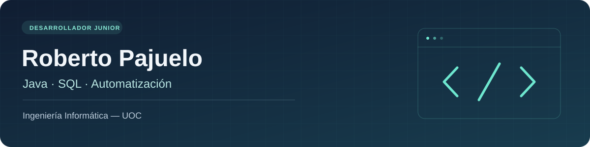

Soy **Roberto**, estudiante de Ingeniería Informática en la **UOC**, orientado al desarrollo **Java y SQL**. Aporto **16 años de experiencia técnica en sistemas de impresión**, diagnóstico y resolución de incidencias.

Aquí reúno proyectos personales, prácticas de formación y colaboraciones con código disponible para revisión.

### Proyectos seleccionados

| Proyecto | Contenido | Evidencia |
| --- | --- | --- |
| **[CUPS Printer Installer](https://github.com/Rpfdeveloper/Scripttoinstallprinters)** | Herramienta Bash para configurar impresoras en Linux, con simulación y actualización controlada de colas. | 25 pruebas con CUPS simulado y CI. Validación con impresora física pendiente. |
| **[PACman · UOC](https://github.com/Rpfdeveloper/PACman)** | Proyecto académico de Java y POO con libGDX y Gradle. | Código organizado por entidades, controlador y pantallas; guía de ejecución y atribuciones docentes. |
| **[UOCoworking · C](https://github.com/Rpfdeveloper/programmingFundamentalsUOC)** | Prácticas de programación estructurada: centros, coworkers, reservas, listas y colas. | Práctica final compilada con GCC; 45 pruebas académicas superadas. El código está en la rama `master`. |
| **[Fundamentos de Java](https://github.com/Rpfdeveloper/Master-Java-Udemy)** | Operadores, control de flujo, strings y programas de consola. | 58 fuentes compiladas con Java 17; calculadora con cinco pruebas de regresión. |
| **[Arrays, matrices y POO](https://github.com/Rpfdeveloper/Master-Java-180h-Udemy)** | Ejercicios de arrays, búsquedas, ordenación, matrices y primeros objetos. | 93 fuentes compiladas con Java 17 e instrucciones para ejecutar ejemplos. |

### Colaboración en código abierto

**[JVM-MCP · Pull request #129](https://github.com/oscarbol09/jvm-mcp/pull/129)**  
Corrección de la serialización JSON de arrays primitivos en Java y 24 pruebas nuevas. Propuesta enviada el 20 de octubre de 2026, con [CI del fork superado en Linux, macOS y Windows](https://github.com/Rpfdeveloper/jvm-mcp/actions/runs/39395994044). El estado de revisión y aceptación se consulta en la pull request.

### Tecnologías que practico

**Java · SQL · C · Bash · Git · Linux · JUnit**

Java y SQL forman parte de mi formación y práctica como desarrollador junior. Las prácticas académicas conservan las atribuciones de sus autores. Las mejoras recientes de documentación, código y pruebas se han preparado con asistencia de IA, indicada en los repositorios y en la contribución.

**[Contacto y trayectoria en LinkedIn](https://www.linkedin.com/in/juliorpf-java-sql/)**
